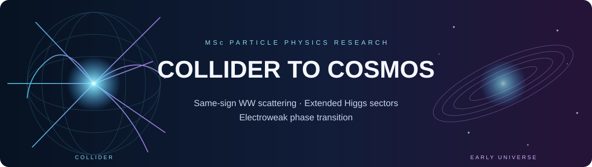
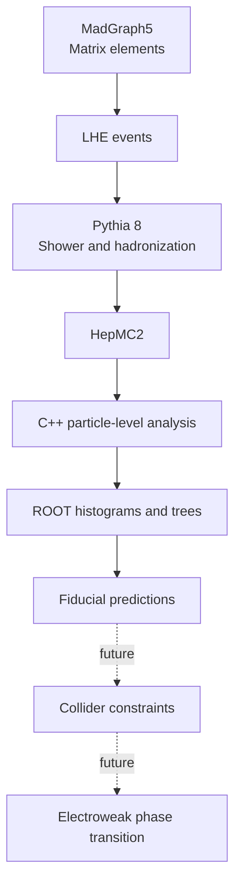

<div align="center">



# Collider to Cosmos

### Same-sign W-boson scattering · Extended Higgs sectors · Electroweak phase transition

**MSc research project in experimental particle physics**

     

[Physics motivation](#physics-motivation) · [Pipeline](#simulation-and-analysis-pipeline) · [Results](#preliminary-results) · [Roadmap](#research-roadmap) · [Reproduce](#build-and-run)

</div>

## Physics motivation

How can measurements of electroweak interactions at the Large Hadron Collider inform our understanding of the Higgs sector and, ultimately, the early Universe?

This project investigates same-sign W-boson scattering in proton–proton collisions at **13 TeV**, starting from Standard Model particle-level predictions and extending to the custodially symmetric Georgi–Machacek (GM) model. Its long-term objective is to connect collider constraints on extended Higgs sectors to the electroweak phase transition.

$$
pp \rightarrow W^{\pm}W^{\pm}jj \rightarrow \ell^{\pm}\nu\,\ell^{\pm}\nu\,jj
$$

The BSM study focuses on the doubly charged custodial-fiveplet scalar $H_5^{\pm\pm}$, which has tree-level gauge-boson couplings but no direct tree-level Yukawa couplings to fermions.

$$
pp \rightarrow H_5^{++}jj \rightarrow W^{+(*)}W^{+(*)}jj \rightarrow \ell^+\nu\,\ell^+\nu\,jj
$$

The current GM sample includes resonant electroweak production topologies with a VBS fiducial selection; it is not an exclusive VBF calculation or a complete SM+GM prediction.

## Simulation and analysis pipeline



The analysis implements lifetime-based particle reconstruction, prompt-lepton ancestry classification, photon dressing, anti-kT jet clustering (R = 0.4), electron–jet overlap removal, b-hadron ghost association, missing transverse momentum and cumulative VBS selections inspired by [ATLAS JHEP 04 (2024) 026](https://arxiv.org/abs/2312.00420).

## Preliminary results

### Standard Model baseline

| Channel | Generated | Selected | Acceptance |
|:--|--:|--:|--:|
| EW W⁺W⁺jj | 10,000 | 1,971 | 19.71% |
| EW W⁻W⁻jj | 10,000 | 1,848 | 18.48% |
| QCD W⁺W⁺jj | 10,000 | 339 | 3.39% |
| QCD W⁻W⁻jj | 10,000 | 291 | 2.91% |

[Four-sample figure (PDF)](results/four_sample_fiducial.pdf) · [Physics gallery](results/physics_gallery/README.md) · [Cross sections](results/cross_sections.csv) · [Cutflows](results/cutflow.csv)

### Georgi–Machacek: first benchmark

| Parameter / observable | Value |
|:--|--:|
| H₅⁺⁺ mass | 150 GeV |
| sin θH | 0.1 |
| Generated events | 10,000 |
| Selected events (general prompt mode) | 1,111 |
| Fiducial acceptance | 11.11% |
| Generator cross section | 0.9597 fb |
| Preliminary fiducial cross section | 0.10662 fb |

A dedicated ancestry audit identified a generator-record-dependent selection bias: the original classifier required explicitly recorded hard W ancestors. The updated prompt classifier recovers the expected 20,000 lepton candidates in the GM sample, increasing selected events from 779 to 1,111, while preserving the SM EW+ baseline exactly at candidate level.

[Prompt-lepton validation](validation/prompt_lepton/README.md) · [qq diagrams](gm_h5pp_diagrams.pdf) · [q–antiquark diagrams](gm_h5pp_diagrams_qqbar.pdf)

> [!IMPORTANT]
> These are preliminary Monte Carlo predictions, not measurements or evidence for a new particle. The EW+ absolute normalization has an unresolved +6.05% pilot/parent discrepancy. Generator-cut dependence, the full ATLAS fiducial audit, remaining SM prompt-mode checks, interference and PDF/scale uncertainties require further work. The general prompt classifier is a signal-sample approximation.

## Research roadmap

- [x] SM EW and QCD same-sign WWjj samples
- [x] C++ particle-level reconstruction and fiducial analysis
- [x] First GM benchmark at 150 GeV
- [x] Prompt ancestry audit and SM EW+ regression test
- [ ] Generator-cut stability and remaining SM validation
- [ ] GM mass scan and differential distributions
- [ ] Collider constraints on GM parameter space
- [ ] Connection to finite-temperature electroweak symmetry breaking

## Repository guide

| Resource | Location |
|:--|:--|
| Active analyzer | [analysis/particle_level.cpp](analysis/particle_level.cpp) |
| Lifetime reconstruction | [reconstruction.h](validation/lifetime_impact/reconstruction.h) |
| SM input references | [data/sm/hepmc/](data/sm/hepmc/) |
| Canonical SM ROOT references | [data/sm/root/](data/sm/root/) |
| Generator configuration | [configs/](configs/README.md) |
| Workflow scripts | [scripts/](scripts/README.md) |
| Numerical results | [results/](results/) |
| Validation status | [docs/VALIDATION_STATUS.md](docs/VALIDATION_STATUS.md) |

## Build and run

<details>
<summary><b>Local environment and reproducible SM replay</b></summary>

Requires the existing `hep` environment, CMake ≥ 3.28, C++17, ROOT/PyROOT, FastJet and the bundled Pythia 8.317/HepMC2 dependencies.

```bash
source /home/naris/miniforge3/etc/profile.d/conda.sh
conda activate hep
export PYTHIA8DATA="$PWD/MG5_aMC_v3_8_0/HEPTools/pythia8/share/Pythia8/xmldoc"
export LD_LIBRARY_PATH="$PWD/MG5_aMC_v3_8_0/HEPTools/pythia8/lib:$PWD/MG5_aMC_v3_8_0/HEPTools/hepmc/lib:$CONDA_PREFIX/lib${LD_LIBRARY_PATH:+:$LD_LIBRARY_PATH}"
cmake -S . -B build/local -DCMAKE_PREFIX_PATH="$CONDA_PREFIX"
cmake --build build/local --target particle_level -j 4
mkdir -p results/replays
./build/local/particle_level lifetime \
    data/sm/hepmc/ew_plus.hepmc \
    results/replays/ew_plus_lifetime_prompt.root prompt
```

Use `directW` to replay the historical classifier (also the current default). Use a fresh output filename; existing outputs are refused. The separate build preserves `build/particle_level`.

View existing results without rebuilding:

```bash
root -l data/sm/root/ew_plus.root
```

The four sample names are `ew_plus`, `ew_minus`, `qcd_plus`, `qcd_minus`. The eight HepMC/ROOT references are relative symlinks to preserved production files. A Git checkout alone does not supply the ignored original datasets. Keep canonical ROOT references unchanged.

</details>

## Reproducibility and provenance

[Project map](docs/PROJECT_MAP.md) · [Reproduction guide](docs/REPRODUCIBILITY.md) · [Results index](docs/RESULTS_INDEX.md) · [Historical results](docs/HISTORICAL_RESULTS.md)

[Sample manifest](results/samples.json) · [Checksums](results/SHA256SUMS) · [Binned distributions](results/distributions.csv) · [Comparison data](results/comparison.json)

Original `production_runs/` and `sm_*` directories remain in place. Generated process trees and MG5 installations are software/provenance, not additional active SM datasets. Historical artifacts are preserved.

---
<div align="center">
<sub>From collider observables to the physics of the early Universe.</sub>
</div>
