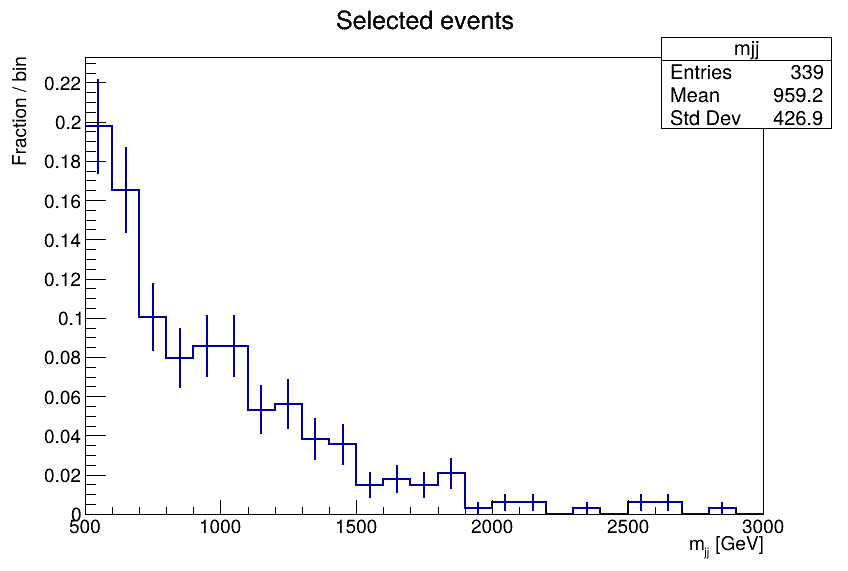
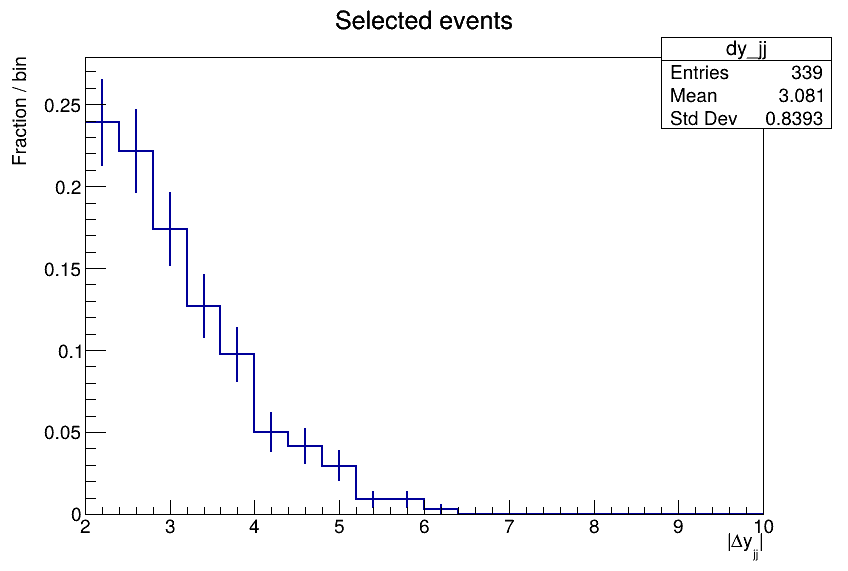
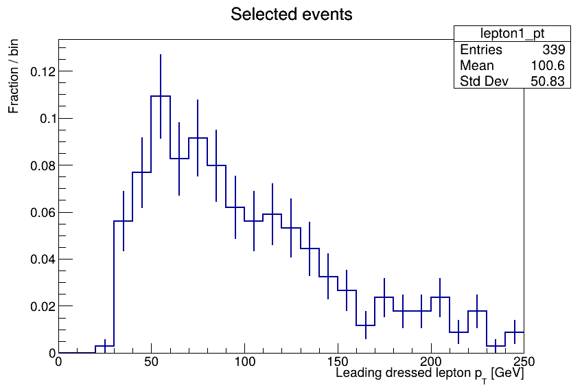
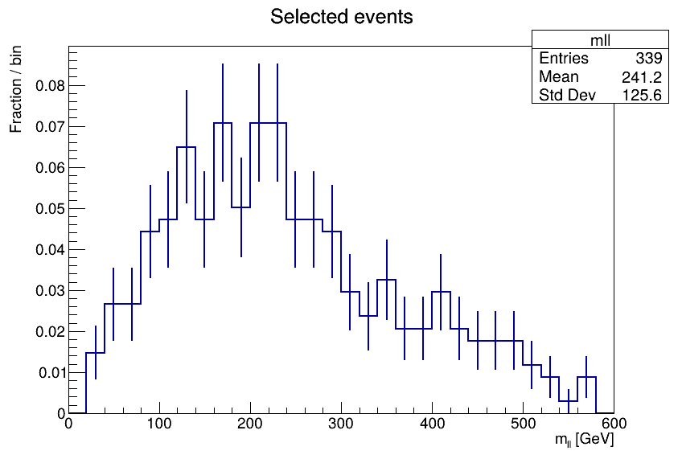
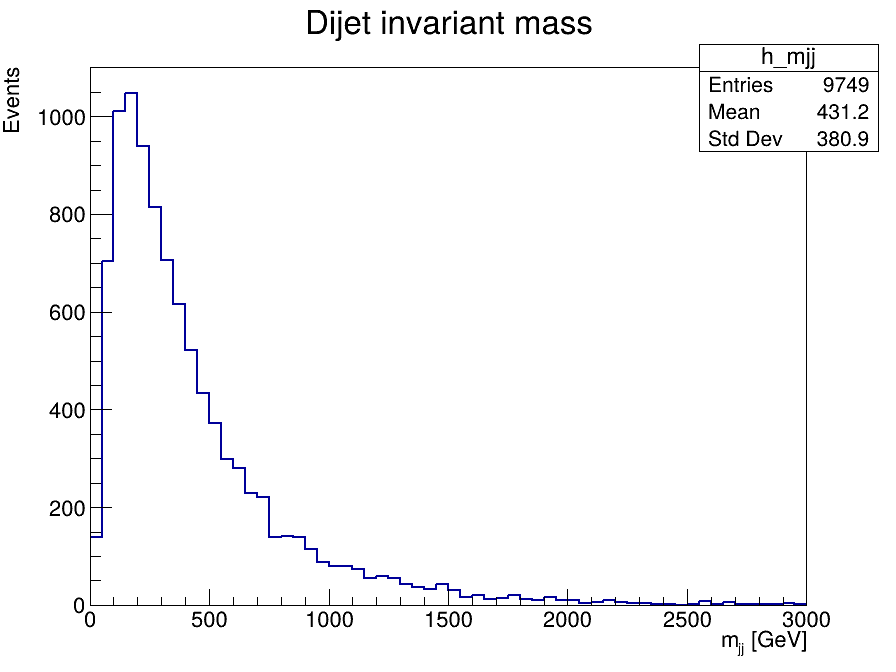
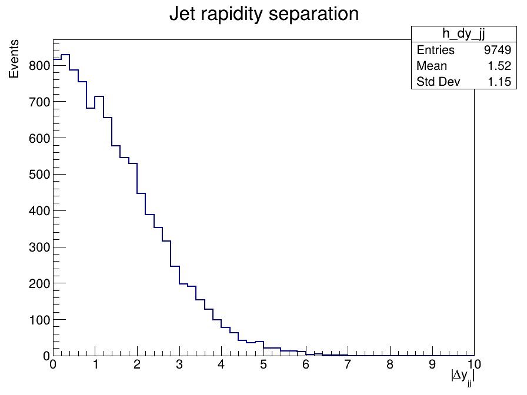
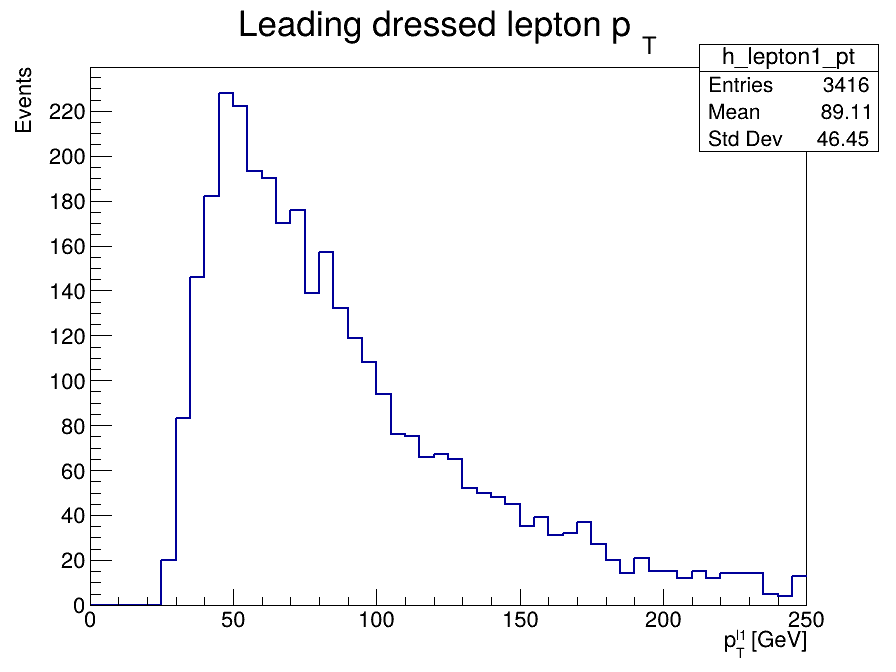
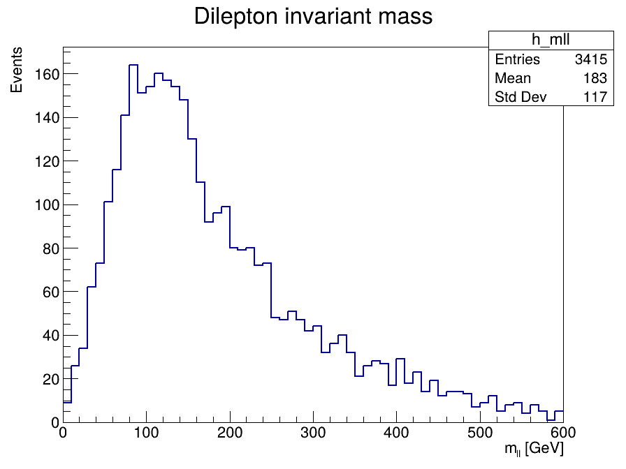

# Collider → Cosmos

### From same-sign WW scattering at the LHC to extended Higgs sectors and the early Universe

**MadGraph5_aMC@NLO → Pythia 8 → HepMC → FastJet → C++/ROOT**

> **Research status:** ATLAS-inspired Standard Model **particle-level baseline**, validated on a 10,000-event electroweak `W+W+jj` simulation. **Not** an official ATLAS analysis or a matched fiducial cross-section measurement.

## The physics question

Vector-boson scattering (VBS) probes the electroweak gauge and scalar sectors at high energies. This project starts with electroweak `pp → W+W+jj`, with both W bosons decaying to electrons/muons and neutrinos, and constructs a reproducible path from generated events to VBS-sensitive observables. The longer-term goal is to study extended Higgs sectors, especially the **Georgi–Machacek model**, and explore their implications for the electroweak phase transition.

## Simulation → analysis

```text
13 TeV pp collisions
    │
    ▼
MadGraph5_aMC@NLO (electroweak W+W+jj, leptonic W decays)
    │  hard-process events
    ▼
Pythia 8 (parton shower, hadronization)
    │
    ▼
HepMC2 event record
    │
    ├── stable e/μ from hard-W decay lineages → photon dressing
    ├── stable neutrinos → missing transverse momentum
    └── stable jet inputs + b-hadron ghosts → FastJet anti-kT R=0.4
                                             │
                                             ▼
                           C++ particle-level object selection
                                             │
                                             ▼
                               ROOT diagnostic histograms + cumulative cutflow
                                             + selected-event TTree
```

## Current sample and result

| Quantity | Value |
|---|---:|
| Process | Electroweak `pp → W+W+jj`, `W+ → ℓ+ν`, ℓ = e, μ |
| Collision energy | √s = 13 TeV |
| Generated events | 10,000 |
| Generator-reported cross section | 0.008951 ± 0.00002036 pb |
| Events passing current selection | **339** |
| Unweighted selection efficiency | **3.39%** |

The generator-reported cross section is taken from the existing run documentation and its uncertainty is the integration uncertainty, **not** the total theory uncertainty. Its normalization, subprocess definition, branching-ratio conventions and event weights must be verified before deriving an absolute fiducial prediction. The 3.39% value is a **sample acceptance**, not an ATLAS-measured efficiency.

### Cumulative selection

| Stage | Events |
|---|---:|
| Generated | 10,000 |
| Exactly two dressed leptons, pT > 27 GeV, abs(η) < 2.5 | 3,259 |
| Same charge | 3,259 |
| mℓℓ > 20 GeV | 3,226 |
| Third prompt-lepton veto | 3,226 |
| Dielectron Z-window veto | 3,116 |
| Missing pT > 30 GeV | 2,730 |
| b-jet veto | 2,649 |
| At least two jets | 2,541 |
| Leading/subleading jet pT ≥ 65/35 GeV | 2,247 |
| mjj > 500 GeV | 772 |
| abs(Δyjj) > 2 | **339** |

**Object definitions (implemented):** direct hard-W e/μ lineage (no τ decay chain); photon dressing using ΔR < 0.1 about **bare** leptons, assigning each photon at most once to its nearest lepton and excluding photons with generator-history hadron-decay ancestry; stable-neutrino vector sum for missing pT; anti-kT R=0.4 jets with muons and neutrinos excluded, electron/photon inputs retained; electron–jet overlap removal; open-bottom-hadron ghost-based b-jet veto. Jet acceptance abs(η) < 4.5; b-jet veto pT > 20 GeV and abs(η) < 2.5. These are **ATLAS-inspired approximations**, not a claim of exact experiment-level equivalence.

## Comparison with published ATLAS measurements

### References

1. **ATLAS, PRL 123 (2019) 161801** — *Observation of Electroweak Production of a Same-Sign W Boson Pair in Association with Two Jets in pp Collisions at √s = 13 TeV*. [DOI](https://doi.org/10.1103/PhysRevLett.123.161801). The paper provides an explicit particle-level fiducial prescription.
2. **ATLAS, JHEP 04 (2024) 026** — *Measurement and interpretation of same-sign W boson pair production in association with two jets in pp collisions at √s = 13 TeV with the ATLAS detector*. [DOI](https://doi.org/10.1007/JHEP04(2024)026) · [CERN record](https://cds.cern.ch/record/2882929). Includes fiducial and differential results and a search for doubly charged Higgs bosons.

### Definition-level comparison against the 2019 ATLAS fiducial region

| Component | This project | ATLAS 2019 fiducial region | Status |
|---|---|---|---|
| Same-sign leptons | Exactly two e/μ from hard-W lineage, pT > 27 GeV, abs(η) < 2.5 | Exactly two e/μ from W, excluding τ decays; same kinematics | Broadly aligned; lineage implementation approximate |
| Photon dressing | ΔR < 0.1; prompt-like ancestry filter, unique assignment | Photon four-momenta within ΔR = 0.1 | Cone aligned; photon provenance/assignment not identical by construction |
| Dilepton mass | mℓℓ > 20 GeV | mℓℓ > 20 GeV | Aligned |
| Dilepton separation | **Not explicitly cut** | ΔRℓℓ > 0.3 | **Missing** |
| Missing transverse momentum | Vector sum of **all stable neutrinos**, magnitude > 30 GeV | Vector sum of the **two highest-pT final-state neutrinos**, magnitude > 30 GeV | **Different definition** |
| Jets | anti-kT R=0.4; jet inputs exclude all muons/neutrinos; selected pT ≥ 25 GeV, abs(η) < 4.5 | anti-kT R=0.4; excludes neutrinos and charged leptons from W decays; jets pT > 35 GeV, abs(η) < 4.5 | **Different inputs / threshold** |
| Lepton–jet overlap | Electron-only, ΔR < 0.4 with pT ratio decision | Event veto if a charged lepton is within ΔR < 0.3 of a jet | **Different prescription** |
| Tagging jets | Leading > 65 GeV, subleading > 35 GeV; mjj > 500 GeV; abs(Δyjj) > 2 | Same tagging-jet and VBS kinematic thresholds | Aligned in principle |
| Additional vetoes | Third-lepton, dielectron Z-window and ghost b-jet veto | Not part of the quoted 2019 particle-level fiducial definition | **Additional selections** |
| Charge channels | **W+W+ only** | **W±W± combined** | **Not directly comparable** |

**Important:** This table compares to the *2019 fiducial prescription*, not an assertion that every object cut matches the 2024 analysis. A separate cut-by-cut audit of the 2024 definition is needed before calling the sample a faithful reproduction.

### Published ATLAS fiducial cross sections — context, NOT a direct comparison

| Measurement | Electroweak fiducial cross section |
|---|---:|
| ATLAS 2019, 36.1 fb⁻¹ | 2.89 fb, with asymmetric statistical/systematic uncertainties |
| ATLAS 2024, 139 fb⁻¹ | **2.92 ± 0.22 (stat.) ± 0.19 (syst.) fb** |

The 2024 ATLAS paper also reports an **inclusive** (EW + interference + QCD) fiducial result of **3.38 ± 0.22 (stat.) ± 0.19 (syst.) fb**. These published results combine same-sign charge configurations and use experiment-defined fiducial regions. **Do not compare 339/10,000, or a cross section obtained by naively multiplying 3.39% by the generator-reported number, directly to these measurements.** First align the signal definition, both charge channels, fiducial cuts, event-weight normalization and generator conventions.

## Validation performed on the current 10k-event sample

| Check | Result | Interpretation |
|---|---|---|
| Hard-W lepton lineage | 20,000 direct-lineage stable e/μ; 2 per generated event | Consistent with the generated signal topology |
| Broad vs direct lineage | 64 broad-only candidates across 32 events | Broad ancestry admits additional candidates |
| Momentum closure | Mean transverse closure 3.81 × 10⁻⁶ GeV; max 0.00417 GeV | Strong generator-record momentum consistency |
| Refined photon dressing | 2,455 in-cone hadron-ancestry photons excluded; 8,704 assigned | Generator-history approximation |
| Paired old/new dressing | Two-lepton count 3,272 → 3,259; **13** events change two-lepton pass/fail | Quantified impact |
| Paired final selection | **339 → 339; 0 events change final pass/fail** | Final event set robust under this dressing change, for this sample |
| b-hadron ghosts | 1,436 last open-bottom hadrons, all status 2 with end vertices | Supports record consistency; does **not** establish weak-decay definition |
| Jet counting | 9,749 events with ≥2 jets before electron–jet overlap removal; 9,529 after | Overlap removal changes jet multiplicity |

**Reading the event counts:** The 9,749 events with at least two jets **before** electron–jet overlap removal and the 9,529 **after** overlap removal are *jet-only diagnostic counts*, evaluated without the preceding lepton/MET/b-jet requirements. The 2,541 events at the `≥2 jets` stage of the unified cutflow **have already passed** the earlier lepton, MET and b-jet selections. The 339 final events are stored in the `fiducial_events` TTree. These counts are not contradictory.

**Validation scope:** These checks test internal consistency and the effect of a particular object-definition change. They do **not** establish agreement with unfolded ATLAS distributions or a validated absolute cross section.

## Figures and ROOT outputs

The analysis writes `analysis/particle_level.root` containing **diagnostic histograms**, a **12-stage cumulative cutflow** (`h_cutflow`) and a selected-event TTree (`fiducial_events`). The latter contains **339 entries** for the current 10,000-event run and eight `double` branches:

| Branch | Selected-event observable |
|---|---|
| `mjj` | Tagging-dijet invariant mass [GeV] |
| `dy_jj` | Absolute tagging-jet rapidity separation |
| `mll` | Dilepton invariant mass [GeV] |
| `lepton1_pt` | Leading dressed-lepton transverse momentum [GeV] |
| `lepton2_pt` | Subleading dressed-lepton transverse momentum [GeV] |
| `met` | Particle-level missing transverse momentum [GeV] |
| `jet1_pt` | Leading tagging-jet transverse momentum [GeV] |
| `jet2_pt` | Subleading tagging-jet transverse momentum [GeV] |

**Diagnostic histograms are not final fiducial distributions.** For example, `h_mjj` and `h_dy_jj` are filled when at least two jets are available, regardless of whether the event passes the full lepton/MET/VBS selection. Their entry counts can therefore be around 9,500 rather than 339. The selected-event TTree is the source for the final fiducial shape plots.

### Selected-event distributions (339 events)

Generated by `analysis/macros/fiducial_shapes.C`; each plot shows a **fraction per bin** with statistical errors, not an ATLAS-data comparison. The four observables are:









### Cumulative cutflow

Generated by `analysis/macros/plot_cutflow.C` from `h_cutflow`:


### Earlier diagnostic distributions

The following plots illustrate intermediate-stage kinematics and **must not** be interpreted as the 339-event selected distributions:









## Reproducibility

The current C++ source is `analysis/particle_level.cpp`, and the analysis is built through the project's CMake configuration. The current executable expects the HepMC2 sample at a **relative local path**:

```text
sm_wpwpjj_leptonic/Events/run_04/tag_1_pythia8_events.hepmc
```

From the `analysis/` directory, in the configured WSL/Linux environment:

```bash
cmake --build ../build
../build/particle_level
```

This creates `particle_level.root` in the working directory.

Inspect the ROOT file and its selected-event tree:

```bash
root -l particle_level.root
```

```cpp
.ls
fiducial_events->Print();
fiducial_events->GetEntries();
fiducial_events->Scan("*", "", "", 5);
.q
```

From `analysis/`, regenerate the selected-event plots:

```bash
root -l -b -q 'macros/fiducial_shapes.C()'
```

This macro writes four PNGs to `plots/fiducial/`. The cutflow macro as supplied saves `cutflow.png` to the **current working directory**; move/copy it into `plots/cutflow.png` for the README figure:

```bash
root -l -b -q 'macros/plot_cutflow.C()'
cp cutflow.png ../plots/cutflow.png
```

**Note:** These commands assume both macro files are present in `analysis/macros/`. The exact generator cards, software versions, input sample checksums, build dependencies, and complete from-scratch instructions still need to be published. The generated samples and locally installed generator are intentionally **not** committed.

## Repository layout

```text
collider_to_cosmos/
├── analysis/
│   ├── particle_level.cpp
│   └── macros/
│       ├── fiducial_shapes.C
│       └── plot_cutflow.C
├── plots/
│   ├── mjj.png                 # diagnostic (intermediate selection)
│   ├── dy_jj.png               # diagnostic
│   ├── lepton1_pt.png          # diagnostic
│   ├── mll.png                 # diagnostic
│   ├── cutflow.png             # cumulative selection
│   └── fiducial/
│       ├── mjj.png             # selected-event fraction/bin
│       ├── dy_jj.png
│       ├── lepton1_pt.png
│       └── mll.png
├── README.md
└── .gitignore
```

This is the **intended documented layout** for the current plots/macros; verify files exist at these paths before committing so GitHub image links render. The local `analysis/particle_level.root`, HepMC event records and build outputs need not be committed.

## Research roadmap

- [x] Electroweak same-sign `W+W+jj` generation and showering
- [x] HepMC2 → FastJet → ROOT particle-level pipeline
- [x] Lepton lineage, MET closure and photon-dressing robustness checks
- [x] Electron–jet overlap removal and b-jet ghost-veto **implementations**
- [ ] Exact ATLAS fiducial-object definitions and selection audit
- [ ] Event-weight and cross-section normalization validation
- [ ] Both `W+W+` and `W−W−` samples
- [ ] ATLAS/HEPData differential comparison with matched definitions
- [ ] Reproducible environment, run cards, checksums and analysis tests
- [ ] Georgi–Machacek benchmarks, collider constraints and finite-temperature electroweak interpretation

**Research principle:** *Physical principle → research question → observable → simulation/code → validation → physical interpretation.*

---

*Independent MSc-level research software project. Not affiliated with or endorsed by the ATLAS Collaboration or CERN.*
