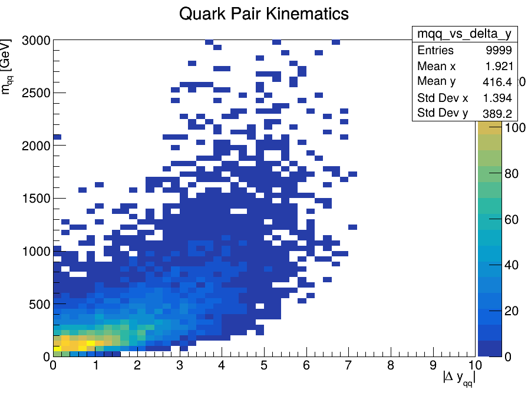
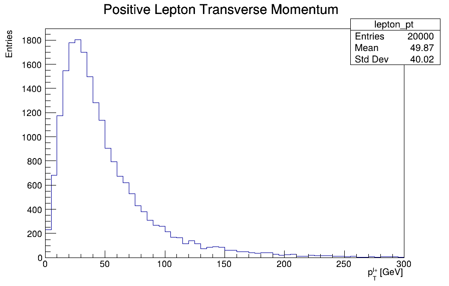
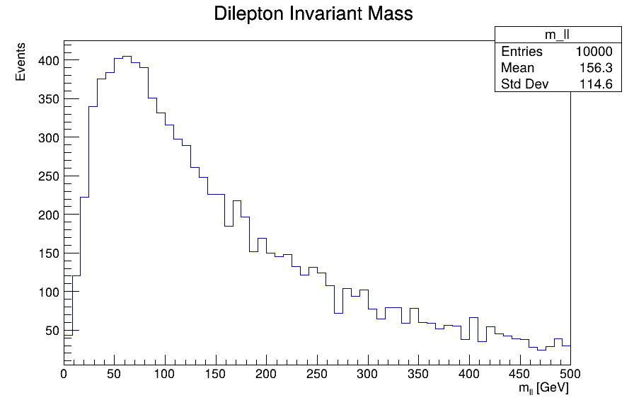
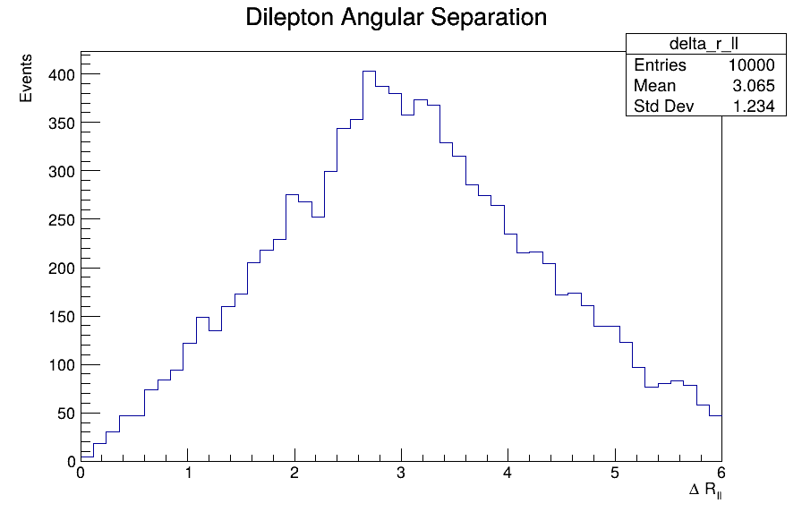
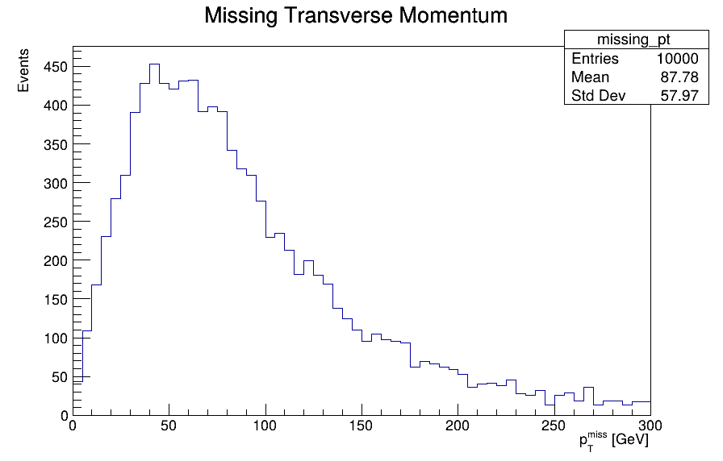

# Collider → Cosmos

**A computational high-energy physics project exploring same-sign W-boson scattering, from hard-scattering event generation to particle-level collider observables and, ultimately, connections to extended Higgs sectors and the electroweak phase transition.**

---

## Overview

**Collider → Cosmos** is a developing research project focused on electroweak same-sign W-boson scattering at the LHC.

The project begins with the Standard Model process

$$
pp \rightarrow W^+W^+jj
$$

and builds a computational workflow from matrix-element event generation to particle-level collider analysis.

The current simulation chain is:

```text
MadGraph5_aMC@NLO
        ↓
Hard-scattering events
        ↓
Pythia 8
        ↓
Parton shower + hadronization
        ↓
HepMC particle-level events
        ↓
FastJet                     [next]
        ↓
Jet reconstruction
        ↓
C++ / ROOT analysis
```

The longer-term goal is to use the validated Standard Model workflow as a foundation for studying extended Higgs sectors, particularly the **Georgi–Machacek model**, and investigating how collider constraints may connect to the physics of the **electroweak phase transition in the early Universe**.

---

## Physics Motivation

Same-sign W-boson scattering is an important vector-boson-scattering (VBS) process at the LHC.

A characteristic electroweak topology contains two energetic forward jets with a large rapidity separation and large dijet invariant mass:

$$
pp \rightarrow W^+W^+jj
$$

For leptonic W-boson decays, the final-state signature considered here is

$$
pp \rightarrow \ell^+\nu\,\ell^+\nu\,jj,
\qquad \ell = e,\mu
$$

Experimentally, this corresponds approximately to:

```text
same-sign charged leptons
        +
missing transverse momentum
        +
two tagging jets
        +
additional QCD activity
```

The VBS topology provides a useful laboratory for studying electroweak symmetry breaking and for searching for modifications of the Standard Model scalar sector.

---

## Current Status

### 1. Standard Model hard-process generation

Electroweak same-sign W-boson scattering events have been generated with **MadGraph5_aMC@NLO**.

The current leptonic sample contains:

```text
Process:       pp → W+ W+ jj
Decay:         W+ → l+ ν
Leptons:       e+, μ+
Events:        10,000
√s:            13 TeV
Cross section: 0.008951 ± 0.00002036 pb
```

The quoted uncertainty is the Monte Carlo integration uncertainty from event generation and should not be interpreted as a full theoretical uncertainty.

---

### 2. C++ / ROOT analysis

A standalone C++ analysis has been developed to read MadGraph LHE events and reconstruct basic kinematic observables.

Implemented quantities include:

- transverse momentum $p_T$
- rapidity $y$
- invariant masses
- rapidity separation
- dilepton invariant mass $m_{\ell\ell}$
- dilepton angular separation $\Delta R_{\ell\ell}$
- truth-level missing transverse momentum from neutrinos

For the original parton-level VBS study, the outgoing matrix-element quarks were used to explore

$$
\Delta y_{qq}
$$

and

$$
m_{qq}
$$

These quantities are useful for understanding the VBS topology but are **not equivalent to experimentally reconstructed jets**.

---

## Selected Results

### Parton-Level VBS Topology

The matrix-element quarks provide a first view of the characteristic VBS topology. In particular, the correlation between their invariant mass and rapidity separation illustrates the kinematic region that will later be reconstructed using particle-level jets.



### Leptonic Final State

After introducing leptonic W decays, the analysis was extended to experimentally motivated final-state quantities.

#### Charged-Lepton Transverse Momentum



#### Dilepton Invariant Mass



#### Dilepton Angular Separation



#### Truth-Level Missing Transverse Momentum

The missing transverse momentum at this stage is constructed directly from the generated neutrino momenta and therefore represents a truth-level quantity.



---

## Pythia 8 Shower and Hadronization

The leptonic MadGraph sample has successfully been passed through **Pythia 8**.

The simulation now includes the transition from the hard scattering to a particle-level event through:

```text
hard partons
     ↓
parton shower
     ↓
hadronization
     ↓
final-state particles
```

The resulting events are stored in **HepMC** format.

This establishes the first:

```text
MadGraph → Pythia → HepMC
```

pipeline in the project.

The current Pythia setup has produced a successful showered event sample. Environment and version configuration will be cleaned and documented before the final production setup is considered reproducible.

---

## Next Milestone: Particle-Level Jets

The next stage is jet reconstruction with **FastJet**.

Stable final-state particles from the Pythia-generated HepMC events will be clustered using the anti-$k_T$ algorithm.

The initial target is

$$
\text{anti-}k_T,\qquad R=0.4
$$

This will allow the parton-level quantities currently constructed from outgoing MadGraph quarks to be replaced by particle-level jet observables:

$$
p_T^j,\qquad
\eta_j,\qquad
\Delta\eta_{jj},\qquad
m_{jj}
$$

A central validation study will therefore follow the evolution:

```text
matrix-element quarks
        ↓
parton shower
        ↓
hadronization
        ↓
particle-level jets
```

and quantify how the characteristic VBS observables change through the simulation chain.

---

## Toward Experimental Observables

The objective is to move progressively from generator-level quantities toward observables that can be compared with particle-level measurements from LHC experiments.

The intended workflow is:

```text
Matrix element
      ↓
Parton shower
      ↓
Hadronization
      ↓
Particle-level objects
      ↓
Fiducial event selection
      ↓
Comparison with unfolded collider distributions
```

The distinction between **parton-level**, **particle-level**, and **detector-level** quantities is treated explicitly throughout the project.

A full detector simulation is not currently part of the baseline workflow.

---

## Long-Term Research Direction

Once the Standard Model VBS baseline is established and validated, the project is intended to investigate physics beyond the Standard Model.

The primary model of interest is the **Georgi–Machacek (GM) model**, which extends the Standard Model Higgs sector with additional scalar triplets while preserving custodial symmetry at tree level.

Of particular interest is the custodial-fiveplet doubly charged scalar

$$
H_5^{++}
$$

which can couple directly to

$$
W^+W^+
$$

This makes same-sign W-boson scattering a natural collider channel for investigating the extended scalar sector.

The longer-term research chain is:

```text
SM same-sign WW VBS
        ↓
Validated collider baseline
        ↓
Georgi–Machacek model
        ↓
Collider constraints on scalar-sector parameters
        ↓
Finite-temperature scalar potential
        ↓
Electroweak phase transition
        ↓
Early-Universe interpretation
```

Possible gravitational-wave phenomenology is considered a later extension rather than part of the current baseline.

---

## Repository Structure

```text
collider_to_cosmos/
│
├── analysis/
│   ├── lhe_reader.cpp
│   └── analysis plots
│
├── README.md
├── .gitignore
│
└── [simulation cards and additional analysis modules to be added]
```

Large generated event samples, local MadGraph installations, compiled binaries, ROOT files and HepMC files are intentionally excluded from version control.

---

## Tools

The project currently uses:

- **C++17**
- **ROOT**
- **MadGraph5_aMC@NLO**
- **Pythia 8**
- **HepMC**
- **Linux / WSL2**
- **Git**

Planned additions include:

- **FastJet**
- particle-level fiducial selections
- comparison with experimental unfolded distributions
- Georgi–Machacek UFO model studies

---

## Project Philosophy

The project is developed around the workflow

$$
\boxed{
\text{Physical principle}
\rightarrow
\text{research question}
\rightarrow
\text{observable}
\rightarrow
\text{simulation/code}
\rightarrow
\text{validation}
\rightarrow
\text{physical interpretation}
}
$$

The emphasis is not only on producing Monte Carlo events, but on understanding how theoretical quantities become experimentally meaningful collider observables.

---

## Status

**Current milestone:** MadGraph → Pythia → HepMC completed.

**Next milestone:** FastJet jet reconstruction and particle-level VBS analysis.

---

*Collider → Cosmos is an ongoing MSc-level high-energy physics research project.*