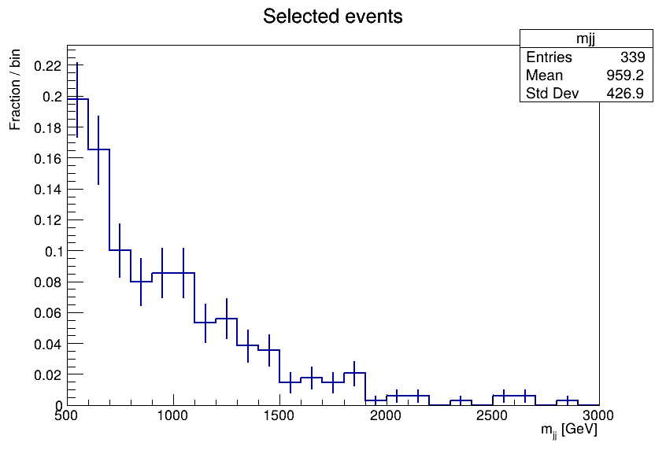
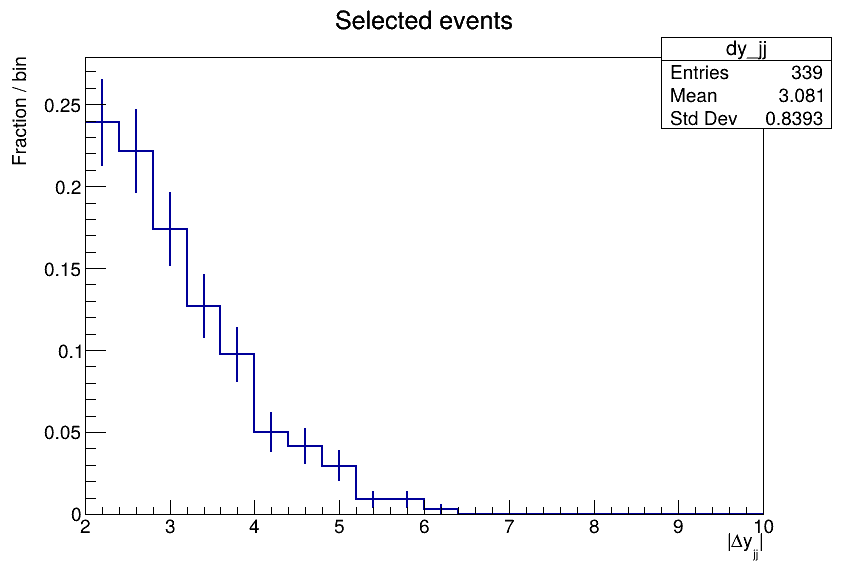
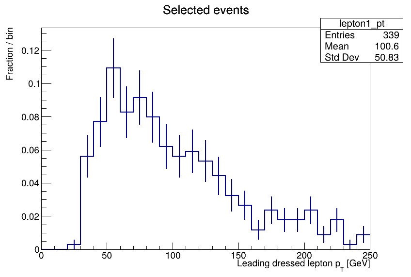
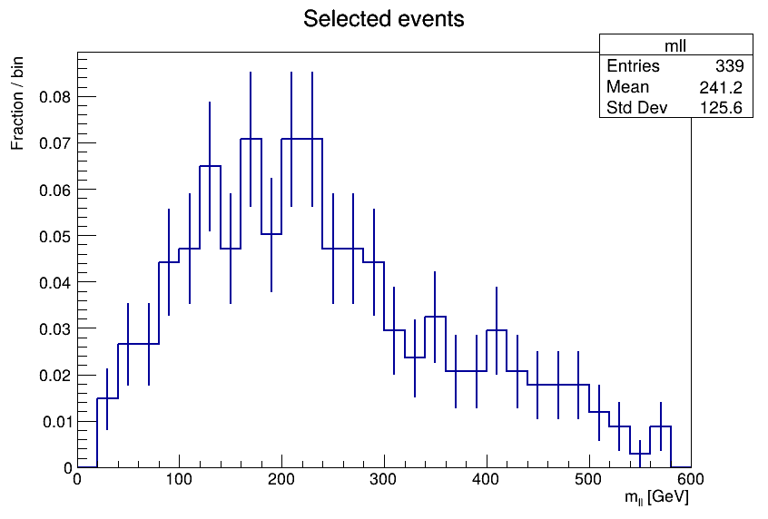
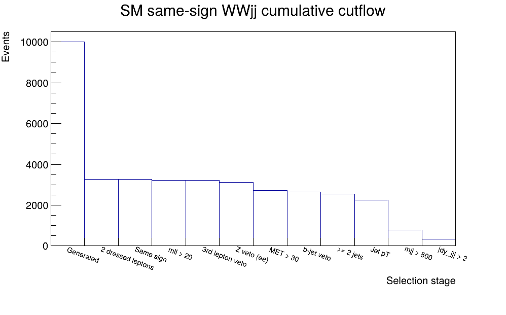
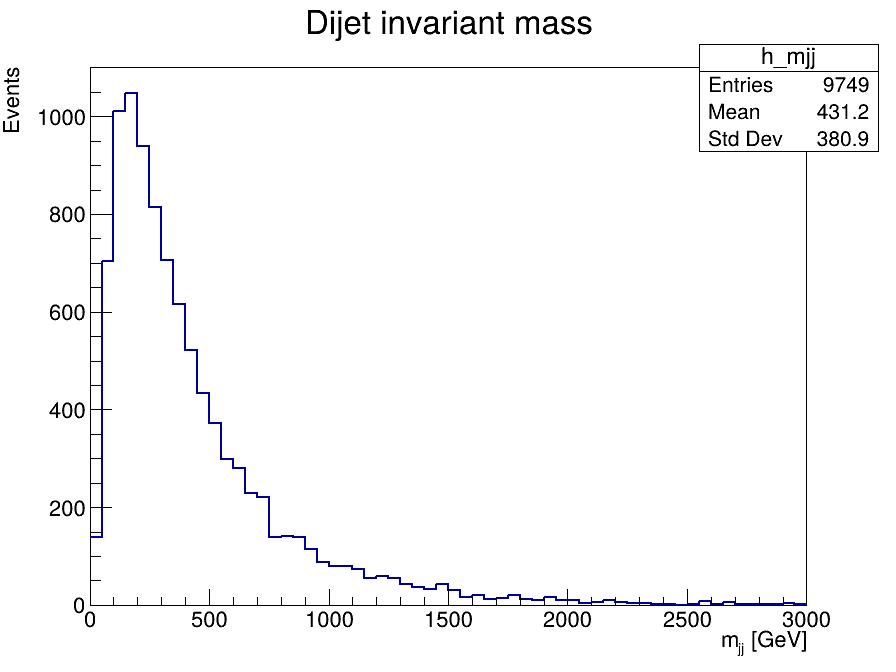
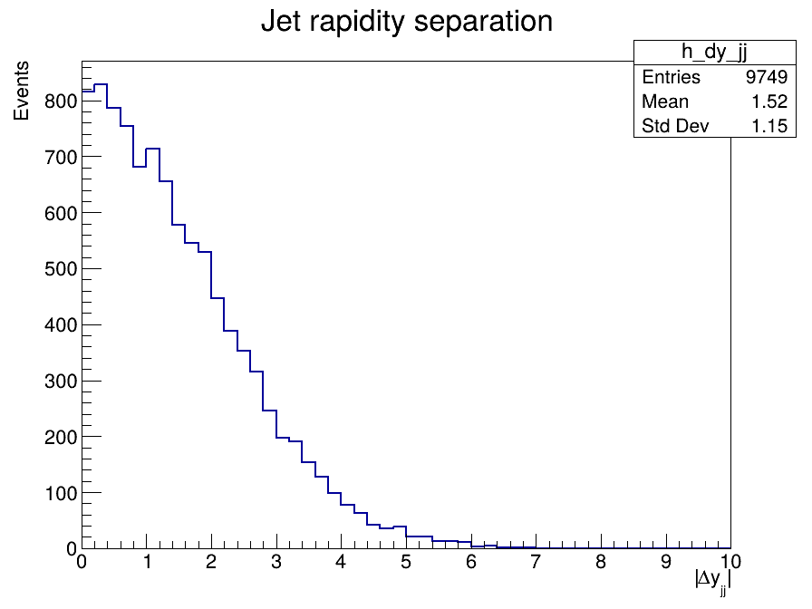
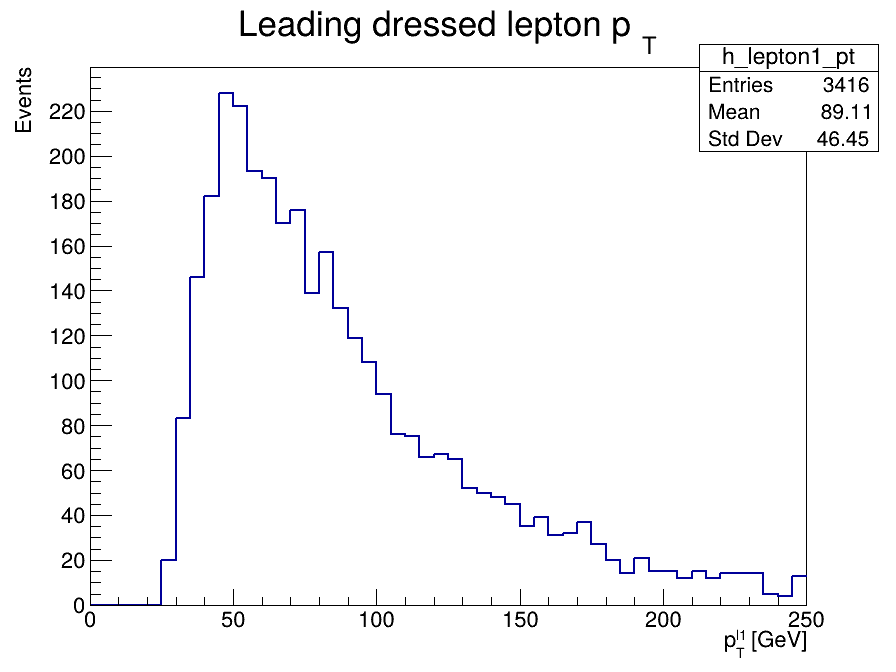
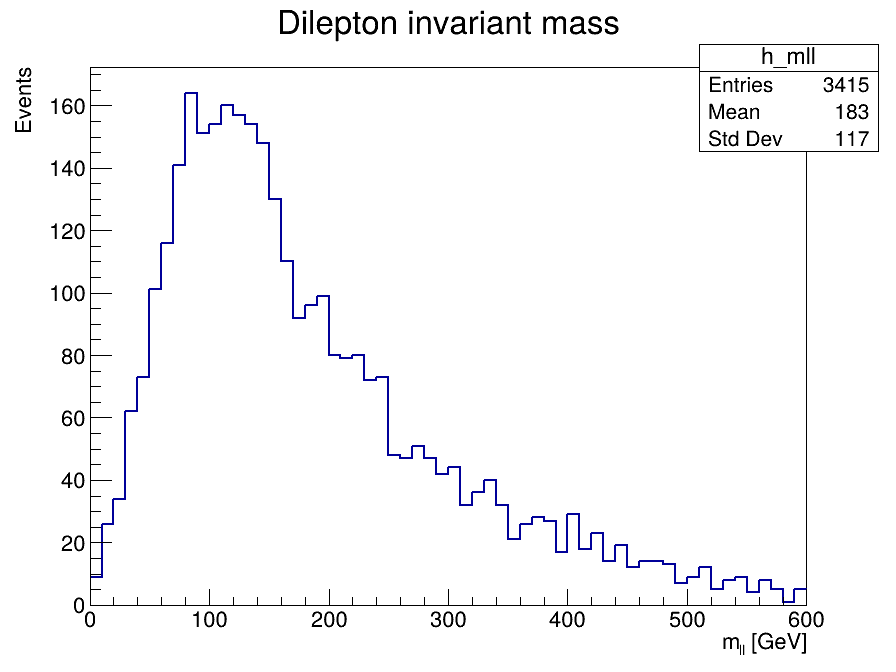

# Historical results and regression references

The active four-sample interface is [data/sm/](../data/sm/), indexed in
[RESULTS_INDEX.md](RESULTS_INDEX.md). All original files remain in place.
Historical means outside the active interface, not disposable. No event or
ROOT file was deleted, moved or regenerated during this organization.

## HepMC inventory outside the four active inputs

Sizes are logical bytes. The large production event counts come from the
existing verification records. Fixture/probe counts count HepMC E records,
not a new physics validation. All listed sources are regular files.

| Repository-relative path | Bytes | Events / purpose | Disposition |
|---|---:|---|---|
| `sm_wpwpjj_leptonic/Events/run_04/tag_1_pythia8_events.hepmc.gz` | 833,569,192 | 10,000; compressed QCD+ representation | Retain; checksum-listed; previous audit records identical decompression |
| `production_runs/ew_wpwpjj_pilot_1000_seed271828/shower/ew_wpwp_1000_seed271828_pythia8317.hepmc` | 217,275,904 | 1,000; EW+ pilot | Retain with production/normalization evidence |
| `sm_wmwmjj_leptonic/Events/run_01/shower_8317/formatted_probe/tag_1_pythia8_events.hepmc` | 113,458 | 1; formatting-control probe | Retain with probe card/log |
| `sm_wmwmjj_leptonic/Events/run_01/tag_1_pythia8_events.hepmc` | 0 | 0; failed shower | Retired 2026-11-20; empty failed output; cards/logs retained |
| `sm_wmwmjj_leptonic/Events/run_01/shower_8317/gz/tag_1_pythia8_events.hepmc` | 0 | 0; failed gzip-input probe | Retired 2026-11-20; empty failed output; cards/logs retained |
| `sm_wmwmjj_leptonic/Events/run_01/shower_8317/plain/tag_1_pythia8_events.hepmc` | 0 | 0; failed plain-input probe | Retired 2026-11-20; empty failed output; cards/logs retained |
| `MG5_aMC_v3_8_0/tests/input_files/test.hepmc.gz` | 978,897 | 10; upstream MG5 fixture | Retain software test input; four copies have identical SHA-256 |
| `MG5_aMC_v3_8_0/tests/input_files/._test.hepmc.gz` | 163 | Not event data; AppleDouble metadata | Outside active datasets; no installation cleanup performed |
| `production_runs/ew_wmwmjj_10000_seed161803/MG5_aMC_v3_8_0/tests/input_files/test.hepmc.gz` | 978,897 | 10; upstream MG5 fixture | Retain software test input; four copies have identical SHA-256 |
| `production_runs/ew_wmwmjj_10000_seed161803/MG5_aMC_v3_8_0/tests/input_files/._test.hepmc.gz` | 163 | Not event data; AppleDouble metadata | Outside active datasets; no installation cleanup performed |
| `production_runs/ew_wpwpjj_50000_seed314159/MG5_aMC_v3_8_0/tests/input_files/test.hepmc.gz` | 978,897 | 10; upstream MG5 fixture | Retain software test input; four copies have identical SHA-256 |
| `production_runs/ew_wpwpjj_50000_seed314159/MG5_aMC_v3_8_0/tests/input_files/._test.hepmc.gz` | 163 | Not event data; AppleDouble metadata | Outside active datasets; no installation cleanup performed |
| `production_runs/ew_wpwpjj_pilot_1000_seed271828/MG5_aMC_v3_8_0/tests/input_files/test.hepmc.gz` | 978,897 | 10; upstream MG5 fixture | Retain software test input; four copies have identical SHA-256 |
| `production_runs/ew_wpwpjj_pilot_1000_seed271828/MG5_aMC_v3_8_0/tests/input_files/._test.hepmc.gz` | 163 | Not event data; AppleDouble metadata | Outside active datasets; no installation cleanup performed |

The original QCD+ compressed/plain identity was not rechecked by streaming
the large file in this pass. Historical shower seeds/chunk invocations are
not fully reconstructed; preserved HepMC files remain reproducibility inputs.

## Empty HepMC retirement — 2026-11-20

The following three zero-byte regular files were explicitly approved and
retired after verifying that no active input, symlink or sample/checksum
manifest required them:

- `sm_wmwmjj_leptonic/Events/run_01/tag_1_pythia8_events.hepmc`.
- `sm_wmwmjj_leptonic/Events/run_01/shower_8317/gz/tag_1_pythia8_events.hepmc`.
- `sm_wmwmjj_leptonic/Events/run_01/shower_8317/plain/tag_1_pythia8_events.hepmc`.

The historical cards name these paths as shower outputs, not consumed event
inputs. Removing the empty failed outputs does not remove any event records
or prevent reproduction into fresh output locations. Failure logs, probe
cards, original LHE, configurations, integrity checks and historical snapshots
remain unchanged. The successful one-event formatted probe is retained.

The active QCD W−W− input is
[data/sm/hepmc/qcd_minus.hepmc](../data/sm/hepmc/qcd_minus.hepmc), resolving to
`sm_wmwmjj_leptonic/Events/run_01/tag_1_pythia8_events_verified.hepmc`.
Do not substitute the retired unverified filename.

A verified rollback record is retained outside the repository at
`/tmp/collider-empty-hepmc-rollback-20261120-z_wjocrz/`, with original relative paths, empty-file copies, modes, timestamps
and SHA-256 checksums. All three empty files have SHA-256
`e3b0c44298fc1c149afbf4c8996fb92427ae41e4649b934ca495991b7852b855`.
The record also preserves the pre-edit historical index and quick reference.
This /tmp location is temporary rollback storage, not a permanent archive.
No other HepMC file was deleted. Restore only after verifying checksums and
confirming the original destinations remain absent; retain the rollback record.

## ROOT inventory outside the four final references

The original inventory contained 19 regular ROOT files. Following the explicitly
approved historical ROOT cleanup on 2026-11-20, 16 remain at their original
paths; the four canonical aliases do not create new copies. The three retired
files remain listed below for traceability. Counts come from stored metadata
and historical records, not a new event analysis.

| Repository-relative path | Bytes | Purpose / dependency | Disposition |
|---|---:|---|---|
| `particle_level.root` | 13,186 | Empty analysis output: 0 analyzed / 0 selected; all histogram bins zero; sample unidentified | Retired 2026-11-20; no scientific data to replace; use the four canonical references |
| `wmwm_particle_level.root` | 34,760 | QCD W−W−: 10,000 analyzed / 291 selected; stored physics payload identical to canonical QCD− | Retired 2026-11-20; replacement: [data/sm/root/qcd_minus.root](../data/sm/root/qcd_minus.root) |
| `wpwp_lifetime_comparison.root` | 37,713 | QCD W+W+: 10,000 analyzed / 339 selected; stored physics payload identical to canonical QCD+ (not EW+) | Retired 2026-11-20; replacement: [data/sm/root/qcd_plus.root](../data/sm/root/qcd_plus.root) |
| `analysis/particle_level.root` | 36,661 | Historical analysis output referenced in previous documentation | Hold for read-only metadata identification |
| `build/particle_level.root` | 10,838 | Historical build-directory output; source/input identity unknown | Hold for read-only metadata identification |
| `production_runs/ew_wpwpjj_pilot_1000_seed271828/shower_particle_level_audit/ew_wpwp_1000_seed271828_lifetime.root` | 29,734 | EW+ pilot: 1,000 analyzed, 209 selected; retain with pilot records | Retain scientific/regression evidence |
| `validation/lifetime_impact/baseline.root` | 36,649 | Status-1 checkpoint; consumed by summarize.py and integration verification | Retain scientific/regression evidence |
| `validation/lifetime_impact/lifetime.root` | 36,673 | Lifetime checkpoint; consumed by integration verification | Retain scientific/regression evidence |
| `validation/lifetime_impact/targeted/baseline.root` | 13,589 | Targeted baseline study of seven input indices; selected-entry count not inferred | Retain scientific/regression evidence |
| `validation/lifetime_impact/targeted/lifetime.root` | 13,611 | Targeted lifetime study; keep with source, CSV, jets.tsv and logs | Retain scientific/regression evidence |
| `validation/lifetime_impact/attempt1/baseline.root` | 36,649 | Failed environment attempt; hash differs from parent baseline.root | Hold for read-only metadata identification |
| `validation/physics_checkpoints/mjj/checkpoint.root` | 37,939 | Pre-VBS/mass/full checkpoint; used by plot.py and lifetime summary | Retain scientific/regression evidence |
| `validation/strict_tagging_pt/lifetime.root` | 37,767 | Strict-threshold regression: 10,000 analyzed / 339 selected | Retain scientific/regression evidence |
| `validation/lifetime_integration/lifetime.root` | 37,781 | Integration reference: 10,000 / 339; consumed by strict-tagging comparator | Retain scientific/regression evidence |
| `validation/lifetime_integration/status1.root` | 37,746 | Paired status-1 integration regression: 10,000 / 339 | Retain scientific/regression evidence |

For unidentified files, a future READ-only inspection should list key
classes/cycles, TTree entries and branches, and h_cutflow labels/counts.
Matching names or sizes alone do not establish identical physics content.
The navigation change itself removed no files. The separate approved retirement
below removed only three top-level historical ROOT files.

## Approved historical ROOT retirement — 2026-11-20

Only `particle_level.root`, `wmwm_particle_level.root` and
`wpwp_lifetime_comparison.root` were approved for deletion, totaling 85,659
logical bytes. Before deletion, their SHA-256 values were reconfirmed against
the investigation record:

```text
5f3d6686f45fd2d539fafc391e87951c6659e6e6e28c0ea1a1e393ecef87700e  particle_level.root
62d4ef19f314622a4f0d73ba31e2bb289d34fa0720c852eb5ab025a62dc9793f  wmwm_particle_level.root
eebaa4985010da0625a563c360ebde8a680321453a6e1268d8199e3462db892c  wpwp_lifetime_comparison.root
```

The empty file contained no selected events or nonzero histogram bins.
For each of the two QCD files, all 13 stored histogram payloads and all nine
branch basket payloads were reconfirmed byte-identical to the respective
canonical ROOT reference, with matching branch schemas, entry counts and
basket boundaries. Different container UUIDs and whole-file hashes do not
represent extra physics information. Comparison used READ-mode ROOT metadata
and stored binary payloads; no event loops, plots or physics analyses ran.

Canonical replacements resolve to these preserved originals:

- QCD−: `production_runs/ew_wmwmjj_10000_seed161803/analysis/qcd_minus_lifetime.root`.
- QCD+: `production_runs/ew_wpwpjj_50000_seed314159/supervisor_10k/analysis/qcd_wpwpjj_archived_run04_lifetime.root`.

A byte-verified rollback backup, preserving repository-relative paths, is at
`/tmp/collider-root-rollback-20261120-9k4mh07p/`. It includes the three ROOT
files, this document before editing, `SHA256SUMS`, and a pre-cleanup repository
state record. This is a local temporary-filesystem rollback location, not a
long-term research archive; retain it until separately authorized otherwise.
To restore, first verify the backup checksums, require the original destinations
to be absent, and copy the ROOT files back to the repository root without
clobbering any existing file. Restoring the previous document requires a
separate check for subsequent documentation edits.

No symlink or active sample manifest depended on these three exact files.
Legacy macros use a working-directory-relative `particle_level.root` name;
use explicit canonical input arguments where supported, or the documented
isolated temporary-link workflow for `analysis/plot_cutflow.C`. Generic names
in the preserved README and historical Git patches/snapshots remain records
of past layouts, not instructions to recreate the retired empty output.

`analysis/particle_level.root`, `build/particle_level.root`, and
`validation/lifetime_impact/attempt1/baseline.root` remain untouched. No
canonical input/result, source, configuration, production or validation
artifact was changed. Historical patches and snapshots remain unchanged.

## Interpreting the preserved notes

The complete previous README follows, with Markdown links rebased for this
directory. Its sample labels, cutflows, commands and roadmap describe earlier
states. In particular, the 339-event archived positive-charge sample is now
identified as QCD-induced in the curated provenance, despite old EW labels.
Use the current results index for all four sample identities and rates.
Some historical commands mention analysis/macros/plot_cutflow.C; the actual
legacy macro is [analysis/plot_cutflow.C](../analysis/plot_cutflow.C).
Historical shell snippets retain their original working-directory assumptions
and must not be executed over existing outputs.

## Preserved previous README

# From Collider Physics to the Early Universe

MSc research software for Standard Model same-sign WWjj production at 13 TeV,
with a later research direction in extended Higgs sectors and the electroweak
phase transition. The current baseline contains separately generated EW and
QCD-induced W⁺W⁺jj and W⁻W⁻jj, with 10,000 analyzed events per sample.

Start with the [curated results](../results/README.md) and
[four-sample provenance index](../docs/RESULTS_INDEX.md). The common analysis is the
existing particle-level `lifetime` selection. Rates are preliminary because
the EW positive generator discrepancy and the ATLAS fiducial audit remain
open. The baseline excludes interference and PDF/scale systematics.
[Validation status](../docs/VALIDATION_STATUS.md)

## Build and use

The workflow uses MadGraph5_aMC@NLO 3.8.0, Pythia 8.317, HepMC2, FastJet,
ROOT and C++17. With the local `hep` Conda environment active and HEPTools
in place, CMake 3.28 or newer can build the `particle_level` target.
[Environment, exact commands and isolated replay](../docs/REPRODUCIBILITY.md)

```bash
replay_build=$(mktemp -d /tmp/collider-build.XXXXXX)
cmake -S . -B "$replay_build" -DCMAKE_PREFIX_PATH="$CONDA_PREFIX"
cmake --build "$replay_build" --target particle_level
"$replay_build/particle_level" lifetime /absolute/path/to/input.hepmc /absolute/path/to/new.root
```


## Repository navigation

- [Project map](../docs/PROJECT_MAP.md), [workflow tools](../scripts/README.md) and [configuration cards](../configs/README.md)
- [Four-sample results](../results/README.md), [historical figures](../plots/legacy_charge_study/README.md) and [release checksums](../results/SHA256SUMS)
- [Cleanup and storage record](../docs/CLEANUP_REPORT.md)

The preserved notes below describe earlier studies. Use the four-sample index
for the current sample identities, counts, normalizations and output paths.

---

# Collider → Cosmos

### From same-sign WW scattering at the LHC to extended Higgs sectors and the early Universe

**MadGraph5_aMC@NLO → Pythia 8 → HepMC → FastJet → C++/ROOT**

> **Research status:** ATLAS-inspired Standard Model **particle-level baseline**, validated on a 10,000-event electroweak `W+W+jj` simulation. **Not** an official ATLAS analysis or a matched fiducial cross-section measurement.

**Stable-particle modes:** new runs default to `lifetime`; use `status1`
to reproduce the original particle collection. See the
[lifetime integration guide](../validation/lifetime_integration/README.md) for
build/run commands, regression results and protected output paths. The
earlier baseline cutflow and plots below are historical references.

**Tagging jets:** the current fiducial cut requires leading `pT > 65 GeV`
and subleading `pT > 35 GeV` (ATLAS 2024 §7.1). Exactly 65 or 35 GeV,
respectively, fails the cut. The historical cutflow below used inclusive
endpoints. See the [strict-threshold regression](../validation/strict_tagging_pt/README.md).


## The physics question

Vector-boson scattering (VBS) probes the electroweak gauge and scalar sectors at high energies. This project starts with electroweak `pp → W+W+jj`, with both W bosons decaying to electrons/muons and neutrinos, and constructs a reproducible path from generated events to VBS-sensitive observables. The longer-term goal is to study extended Higgs sectors, especially the **Georgi–Machacek model**, and explore their implications for the electroweak phase transition.

## Simulation → analysis

```text
13 TeV pp collisions
    │
    ▼
MadGraph5_aMC@NLO (electroweak W+W+jj, leptonic W decays)
    │  hard-process events
    ▼
Pythia 8 (parton shower, hadronization)
    │
    ▼
HepMC2 event record
    │
    ├── stable e/μ from hard-W decay lineages → photon dressing
    ├── stable neutrinos → missing transverse momentum
    └── stable jet inputs + b-hadron ghosts → FastJet anti-kT R=0.4
                                             │
                                             ▼
                           C++ particle-level object selection
                                             │
                                             ▼
                               ROOT diagnostic histograms + cumulative cutflow
                                             + selected-event TTree
```

## Current sample and result

| Quantity | Value |
|---|---:|
| Process | Electroweak `pp → W+W+jj`, `W+ → ℓ+ν`, ℓ = e, μ |
| Collision energy | √s = 13 TeV |
| Generated events | 10,000 |
| Generator-reported cross section | 0.008951 ± 0.00002036 pb |
| Events passing current selection | **339** |
| Unweighted selection efficiency | **3.39%** |

The generator-reported cross section is taken from the existing run documentation and its uncertainty is the integration uncertainty, **not** the total theory uncertainty. Its normalization, subprocess definition, branching-ratio conventions and event weights must be verified before deriving an absolute fiducial prediction. The 3.39% value is a **sample acceptance**, not an ATLAS-measured efficiency.

### Cumulative selection

| Stage | Events |
|---|---:|
| Generated | 10,000 |
| Exactly two dressed leptons, pT > 27 GeV, abs(η) < 2.5 | 3,259 |
| Same charge | 3,259 |
| mℓℓ > 20 GeV | 3,226 |
| Third prompt-lepton veto | 3,226 |
| Dielectron Z-window veto | 3,116 |
| Missing pT > 30 GeV | 2,730 |
| b-jet veto | 2,649 |
| At least two jets | 2,541 |
| Leading/subleading jet pT ≥ 65/35 GeV | 2,247 |
| mjj > 500 GeV | 772 |
| abs(Δyjj) > 2 | **339** |

**Object definitions (implemented):** direct hard-W e/μ lineage (no τ decay chain); photon dressing using ΔR < 0.1 about **bare** leptons, assigning each photon at most once to its nearest lepton and excluding photons with generator-history hadron-decay ancestry; stable-neutrino vector sum for missing pT; anti-kT R=0.4 jets with muons and neutrinos excluded, electron/photon inputs retained; electron–jet overlap removal; open-bottom-hadron ghost-based b-jet veto. Jet acceptance abs(η) < 4.5; b-jet veto pT > 20 GeV and abs(η) < 2.5. These are **ATLAS-inspired approximations**, not a claim of exact experiment-level equivalence.

## Comparison with published ATLAS measurements

### References

1. **ATLAS, PRL 123 (2019) 161801** — *Observation of Electroweak Production of a Same-Sign W Boson Pair in Association with Two Jets in pp Collisions at √s = 13 TeV*. [DOI](https://doi.org/10.1103/PhysRevLett.123.161801). The paper provides an explicit particle-level fiducial prescription.
2. **ATLAS, JHEP 04 (2024) 026** — *Measurement and interpretation of same-sign W boson pair production in association with two jets in pp collisions at √s = 13 TeV with the ATLAS detector*. [DOI](https://doi.org/10.1007/JHEP04(2024)026) · [CERN record](https://cds.cern.ch/record/2882929). Includes fiducial and differential results and a search for doubly charged Higgs bosons.

### Definition-level comparison against the 2019 ATLAS fiducial region

| Component | This project | ATLAS 2019 fiducial region | Status |
|---|---|---|---|
| Same-sign leptons | Exactly two e/μ from hard-W lineage, pT > 27 GeV, abs(η) < 2.5 | Exactly two e/μ from W, excluding τ decays; same kinematics | Broadly aligned; lineage implementation approximate |
| Photon dressing | ΔR < 0.1; prompt-like ancestry filter, unique assignment | Photon four-momenta within ΔR = 0.1 | Cone aligned; photon provenance/assignment not identical by construction |
| Dilepton mass | mℓℓ > 20 GeV | mℓℓ > 20 GeV | Aligned |
| Dilepton separation | **Not explicitly cut** | ΔRℓℓ > 0.3 | **Missing** |
| Missing transverse momentum | Vector sum of **all stable neutrinos**, magnitude > 30 GeV | Vector sum of the **two highest-pT final-state neutrinos**, magnitude > 30 GeV | **Different definition** |
| Jets | anti-kT R=0.4; jet inputs exclude all muons/neutrinos; selected pT ≥ 25 GeV, abs(η) < 4.5 | anti-kT R=0.4; excludes neutrinos and charged leptons from W decays; jets pT > 35 GeV, abs(η) < 4.5 | **Different inputs / threshold** |
| Lepton–jet overlap | Electron-only, ΔR < 0.4 with pT ratio decision | Event veto if a charged lepton is within ΔR < 0.3 of a jet | **Different prescription** |
| Tagging jets | Leading > 65 GeV, subleading > 35 GeV; mjj > 500 GeV; abs(Δyjj) > 2 | Same tagging-jet and VBS kinematic thresholds | Aligned in principle |
| Additional vetoes | Third-lepton, dielectron Z-window and ghost b-jet veto | Not part of the quoted 2019 particle-level fiducial definition | **Additional selections** |
| Charge channels | **W+W+ only** | **W±W± combined** | **Not directly comparable** |

**Important:** This table compares to the *2019 fiducial prescription*, not an assertion that every object cut matches the 2024 analysis. A separate cut-by-cut audit of the 2024 definition is needed before calling the sample a faithful reproduction.

### Published ATLAS fiducial cross sections — context, NOT a direct comparison

| Measurement | Electroweak fiducial cross section |
|---|---:|
| ATLAS 2019, 36.1 fb⁻¹ | 2.89 fb, with asymmetric statistical/systematic uncertainties |
| ATLAS 2024, 139 fb⁻¹ | **2.92 ± 0.22 (stat.) ± 0.19 (syst.) fb** |

The 2024 ATLAS paper also reports an **inclusive** (EW + interference + QCD) fiducial result of **3.38 ± 0.22 (stat.) ± 0.19 (syst.) fb**. These published results combine same-sign charge configurations and use experiment-defined fiducial regions. **Do not compare 339/10,000, or a cross section obtained by naively multiplying 3.39% by the generator-reported number, directly to these measurements.** First align the signal definition, both charge channels, fiducial cuts, event-weight normalization and generator conventions.

## Validation performed on the current 10k-event sample

| Check | Result | Interpretation |
|---|---|---|
| Hard-W lepton lineage | 20,000 direct-lineage stable e/μ; 2 per generated event | Consistent with the generated signal topology |
| Broad vs direct lineage | 64 broad-only candidates across 32 events | Broad ancestry admits additional candidates |
| Momentum closure | Mean transverse closure 3.81 × 10⁻⁶ GeV; max 0.00417 GeV | Strong generator-record momentum consistency |
| Refined photon dressing | 2,455 in-cone hadron-ancestry photons excluded; 8,704 assigned | Generator-history approximation |
| Paired old/new dressing | Two-lepton count 3,272 → 3,259; **13** events change two-lepton pass/fail | Quantified impact |
| Paired final selection | **339 → 339; 0 events change final pass/fail** | Final event set robust under this dressing change, for this sample |
| b-hadron ghosts | 1,436 last open-bottom hadrons, all status 2 with end vertices | Supports record consistency; does **not** establish weak-decay definition |
| Jet counting | 9,749 events with ≥2 jets before electron–jet overlap removal; 9,529 after | Overlap removal changes jet multiplicity |

**Reading the event counts:** The 9,749 events with at least two jets **before** electron–jet overlap removal and the 9,529 **after** overlap removal are *jet-only diagnostic counts*, evaluated without the preceding lepton/MET/b-jet requirements. The 2,541 events at the `≥2 jets` stage of the unified cutflow **have already passed** the earlier lepton, MET and b-jet selections. The 339 final events are stored in the `fiducial_events` TTree. These counts are not contradictory.

**Validation scope:** These checks test internal consistency and the effect of a particular object-definition change. They do **not** establish agreement with unfolded ATLAS distributions or a validated absolute cross section.

## Figures and ROOT outputs

The analysis writes a mode-specific ROOT file containing **diagnostic histograms**, a **12-stage cumulative cutflow** (`h_cutflow`) and a selected-event TTree (`fiducial_events`). The latter contains **339 entries** for the current 10,000-event run and eight `double` observables plus the one-based sequential index:

| Branch | Selected-event observable |
|---|---|
| `event_index` | Sequential index in the input HepMC file (one-based) |
| `mjj` | Tagging-dijet invariant mass [GeV] |
| `dy_jj` | Absolute tagging-jet rapidity separation |
| `mll` | Dilepton invariant mass [GeV] |
| `lepton1_pt` | Leading dressed-lepton transverse momentum [GeV] |
| `lepton2_pt` | Subleading dressed-lepton transverse momentum [GeV] |
| `met` | Particle-level missing transverse momentum [GeV] |
| `jet1_pt` | Leading tagging-jet transverse momentum [GeV] |
| `jet2_pt` | Subleading tagging-jet transverse momentum [GeV] |

**Diagnostic histograms are not final fiducial distributions.** For example, `h_mjj` and `h_dy_jj` are filled when at least two jets are available, regardless of whether the event passes the full lepton/MET/VBS selection. Their entry counts can therefore be around 9,500 rather than 339. The selected-event TTree is the source for the final fiducial shape plots.

### Selected-event distributions (339 events)

Generated by `analysis/macros/fiducial_shapes.C`; each plot shows a **fraction per bin** with statistical errors, not an ATLAS-data comparison. The four observables are:









### Cumulative cutflow

Generated by `analysis/macros/plot_cutflow.C` from `h_cutflow`:



### Earlier diagnostic distributions

The following plots illustrate intermediate-stage kinematics and **must not** be interpreted as the 339-event selected distributions:









## Reproducibility

The current C++ source is `analysis/particle_level.cpp`, and the analysis is built through the project's CMake configuration. The current executable expects the HepMC2 sample at a **relative local path**:

```text
sm_wpwpjj_leptonic/Events/run_04/tag_1_pythia8_events.hepmc
```

From the `analysis/` directory, in the configured WSL/Linux environment:

```bash
cmake --build ../build
../build/particle_level
```

This creates `particle_level_lifetime.root` in the working directory. Run
`../build/particle_level status1` for `particle_level_status1.root`. Existing
files are refused. The historical `particle_level.root` is preserved.

Inspect the ROOT file and its selected-event tree:

```bash
root -l particle_level_lifetime.root
```

```cpp
.ls
fiducial_events->Print();
fiducial_events->GetEntries();
fiducial_events->Scan("*", "", "", 5);
.q
```

The following historical command reads `particle_level.root` and writes to
fixed plot destinations. Use an isolated directory before making new plots
so the previous figures are preserved:

```bash
root -l -b -q 'macros/fiducial_shapes.C()'
```

This macro writes four PNGs to `plots/fiducial/`. The cutflow macro as supplied saves `cutflow.png` to the **current working directory**; move/copy it into `plots/cutflow.png` for the README figure:

```bash
root -l -b -q 'macros/plot_cutflow.C()'
cp cutflow.png ../plots/cutflow.png
```

**Note:** These commands assume both macro files are present in `analysis/macros/`. The exact generator cards, software versions, input sample checksums, build dependencies, and complete from-scratch instructions still need to be published. The generated samples and locally installed generator are intentionally **not** committed.

## Repository layout

```text
collider_to_cosmos/
├── analysis/
│   ├── particle_level.cpp
│   └── macros/
│       ├── fiducial_shapes.C
│       └── plot_cutflow.C
├── plots/
│   ├── mjj.png                 # diagnostic (intermediate selection)
│   ├── dy_jj.png               # diagnostic
│   ├── lepton1_pt.png          # diagnostic
│   ├── mll.png                 # diagnostic
│   ├── cutflow.png             # cumulative selection
│   └── fiducial/
│       ├── mjj.png             # selected-event fraction/bin
│       ├── dy_jj.png
│       ├── lepton1_pt.png
│       └── mll.png
├── README.md
└── .gitignore
```

This is the **intended documented layout** for the current plots/macros; verify files exist at these paths before committing so GitHub image links render. The local `analysis/particle_level.root`, HepMC event records and build outputs need not be committed.

## Research roadmap

- [x] Electroweak same-sign `W+W+jj` generation and showering
- [x] HepMC2 → FastJet → ROOT particle-level pipeline
- [x] Lepton lineage, MET closure and photon-dressing robustness checks
- [x] Electron–jet overlap removal and b-jet ghost-veto **implementations**
- [ ] Exact ATLAS fiducial-object definitions and selection audit
- [ ] Event-weight and cross-section normalization validation
- [ ] Both `W+W+` and `W−W−` samples
- [ ] ATLAS/HEPData differential comparison with matched definitions
- [ ] Reproducible environment, run cards, checksums and analysis tests
- [ ] Georgi–Machacek benchmarks, collider constraints and finite-temperature electroweak interpretation

**Research principle:** *Physical principle → research question → observable → simulation/code → validation → physical interpretation.*

---

*Independent MSc-level research software project. Not affiliated with or endorsed by the ATLAS Collaboration or CERN.*
